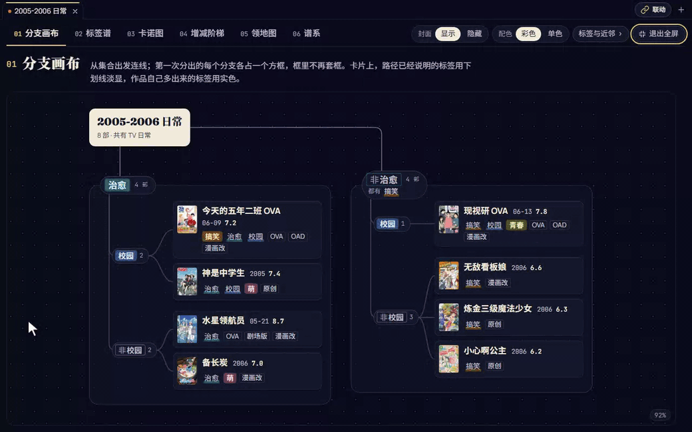

# 山羊五月哭

「猜猜呗」（[anime-character-guessr](https://github.com/kennylimz/anime-character-guessr)）是一个猜动画角色的网页游戏。
山羊五月哭是在本机运行的猜猜呗出题器，用来练猜猜呗：用条件圈出一个角色题库，从里面抽题单人猜；也可以把题库里的角色画成导图来背。角色和作品数据来自 [Bangumi 番组计划](https://bgm.tv)，角色标签来自猜猜呗。

## 亮点

### 圈题库，抽一题

用「范围 + 条件」圈题库，例如「2022 年热度前 100 部动画的主角里，作品带『百合』标签的」。改条件时能看到题库里还剩多少人，点一下抽一题。

### 单人猜猜呗 × 导图联动

用圈好的题库出题，在出题器里直接猜，反馈和猜猜呗游戏一致；下一题按你记得牢不牢来安排。
旁边开着导图并点「联动」后，每猜完一题，导图就跳到答案所在的那张图，标亮答案的作品，也标出你猜错的作品。

### 导图

把题库里的角色画成导图，按作品标签分组，方便背。点作品会标亮标签相近的作品，点标签会标亮带这个标签的作品。导图有六种视图，可以在出题器里看，也能导出成 Obsidian 的 `.canvas` 文件。自带 306 张样例导图。

### AI 辅助（可选）

一句话让 AI 填工作台的条件，或者用一句话查数据库。可以用你自己的 API（DeepSeek、通义千问、Kimi、OpenAI 等，也可以接本机的 Ollama），也可以直接用本机已登录的 Claude Code 或 Codex。都不配置也不影响其他功能。设置方法见 [AI 设置](docs/ai.md)。

## 安装和启动

需要 Python 3.10 或更高、Node.js 20.19 或更高（版本细节见[使用说明](docs/guide.md#安装细节)）。

1. **下载代码**：`git clone`，或者下载 zip。
2. **装依赖**：Windows 双击 `setup-deps.bat`；macOS / Linux 运行 `bash setup-deps.sh`。
3. **放数据库**：在本仓库的 Releases 页面下载 `ccb-goat-may-cry-data-<日期>.zip`（约 200MB），解压后把里面的两个 `.sqlite` 文件（共约 700MB）放进仓库根目录的 `data/` 文件夹（没有就新建）。
4. **启动**：Windows 双击 `start-all.bat`；macOS / Linux 运行 `bash start-all.sh`。浏览器会打开 <http://127.0.0.1:5175>。第一次加载数据库要十几秒，页面上的连接指示灯变绿就好了。
5. **选公式角色**：第一次打开会让你选一组「公式角色」（每局开头先猜的 2–3 个角色），出题器按它们的标签给常用标签分档。不想选可以点「先不选，用默认分档」。

## 更多说明

- [使用说明](docs/guide.md)：各个页面、标签分档、样例导图、数据更新、换端口、壁纸、常见问题
- [AI 设置](docs/ai.md)：怎么填 API、每次请求发送什么
- [联网和隐私](docs/privacy.md)：哪些功能会连网、连到哪里
- [经典工作台和自动点击](docs/legacy.md)：早期版本留下来的两个功能

## 许可证

- 代码使用 [MIT 许可证](LICENSE)。
- 例外：`backend/v2/solo/feedback.py` 移植自上游 anime-character-guessr，沿用上游的 CC BY-NC 4.0（禁止商用），详见 [NOTICE.md](NOTICE.md)。
- 数据包（在 Releases 页面下载）：作品和角色数据来自 Bangumi 番组计划；角色标签来自上游 anime-character-guessr，沿用 CC BY-NC 4.0（禁止商用），详见 [NOTICE.md](NOTICE.md)。

## 致谢

- [kennylimz/anime-character-guessr](https://github.com/kennylimz/anime-character-guessr)：猜猜呗游戏本身。出题器的标签规则和单人猜猜呗的反馈规则都以它为准，角色标签数据也来自它。
- [Bangumi 番组计划](https://bgm.tv)：角色、作品和作品标签数据。
